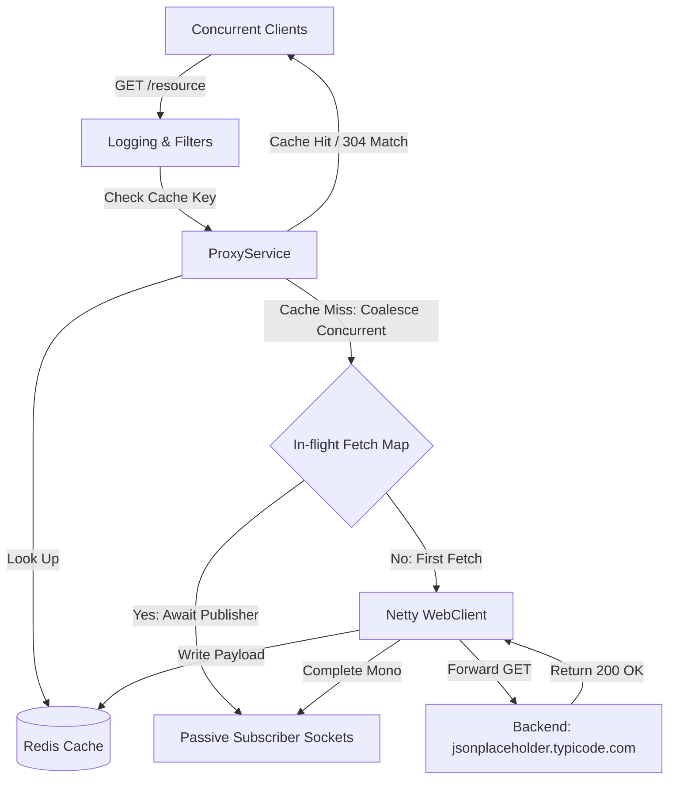

# Reactive HTTP Caching Reverse Proxy

A production-grade, high-performance **HTTP Caching Reverse Proxy** built from scratch using Java 21, Spring Boot 3, Spring WebFlux, Reactor Netty, and Redis.

Designed with reactive, non-blocking principles to serve cached responses under high-concurrency conditions with minimal memory and CPU overhead.

---

## 🚀 Key Highlights & Architecture

### High-Concurrency Reactive Design
Unlike traditional blocking architectures (which assign one OS thread per client request), this proxy utilizes **Project Reactor** and **Reactor Netty**. It services hundreds of concurrent client connections using a small, fixed pool of event loop threads, avoiding thread-context-switching overhead and maximizing throughput.



---

## ⚡ Core Technical Features

### 1. Cache Stampede Protection (Request Coalescing)
* **Problem**: Under high load, if a popular cache key expires, dozens of concurrent requests hit the cache at the same instant, miss, and flood the backend database simultaneously (Cache Stampede).
* **Solution**: An in-memory concurrent map coalesces duplicate requests. The first connection triggers the backend fetch and registers a hot, replaying publisher (`.cache()`). Subsequent duplicate requests subscribe to the same hot publisher, waiting for a single backend request to resolve. Sockets are isolated by wrapping copied heap bytes in clean `DataBuffer` instances to prevent Netty reference-counting corruption.

### 2. Alphabetic Query Normalization
* Standardizes cache keys by sorting incoming query parameters alphabetically (e.g., `/get?a=1&b=2` and `/get?b=2&a=1` resolve to the same normalized key `proxy:cache:GET:/get:a=1&b=2`).

### 3. Dynamic HTTP Caching Rules (RFC 9111)
* **TTL Evaluator**: Parses `Cache-Control` directives (`s-maxage`, `max-age`) and falls back to `Expires` GMT headers, with a 5-minute fallback limit.
* **Cacheability Check**: Filters out responses containing `no-store` or `private` instructions.
* **Conditional Validation (304 Not Modified)**: Compares incoming client headers (`If-None-Match`, `If-Modified-Since`) against cached responses. If validation matches, returns a `304 Not Modified` header with **zero body payload**, saving bandwidth.

### 4. Non-Blocking Admin Operations
* **Scanning Purge**: `DELETE /cache` cleans the cache space safely using cursor-based `SCAN` commands instead of blocking single-threaded `KEYS`.
* **Targeted Eviction**: Supports specific path clearing `DELETE /cache/**` with path validation.

### 5. Resilient Connection & Error Mapping
* Bypasses Redis gracefully if the cache is down.
* Intercepts reactor-netty exceptions (`ReadTimeoutException`, `ConnectException`) wrapped inside WebFlux layers and translates them to clean, structured JSON Gateway payloads:
  * Connection Failure $\rightarrow$ `502 Bad Gateway`
  * Read Timeout $\rightarrow$ `504 Gateway Timeout`

---

## 🛠️ Tech Stack
* **Java**: 21 (LTS)
* **Spring Boot**: 3.4.2 (Reactive WebFlux starter)
* **Redis Client**: Lettuce (non-blocking reactive driver)
* **Testing**: JUnit 5, Mockito, StepVerifier (reactor-test)
* **Build Tool**: Maven

---

## 📋 Running the Application

### 1. Prerequisite: Run Redis
A `docker-compose.yml` file is provided to launch Redis:
```bash
docker compose up -d
```

### 2. Start the Proxy Server
Build and boot the Spring application:
```bash
mvn spring-boot:run
```
The reverse proxy starts on port `8080` and forwards requests to the configured backend (default: `https://jsonplaceholder.typicode.com`).

---

## ⚙️ Configuration (environment variables)

| Variable | Default | Purpose |
|---|---|---|
| `PORT` | `8080` | HTTP port |
| `REDIS_URL` | `redis://localhost:6379` | Redis connection (`rediss://` for TLS, e.g. Upstash) |
| `PROXY_BACKEND_URL` | `https://jsonplaceholder.typicode.com` | Upstream origin |
| `PROXY_ADMIN_TOKEN` | *(empty)* | If set, `DELETE /cache*` requires header `X-Admin-Token` |
| `PROXY_MAX_BODY_BYTES` | `10485760` | Max upstream body buffered/cached |
| `PROXY_CONNECT_TIMEOUT_MS` / `PROXY_READ_TIMEOUT_MS` | `5000` | Upstream timeouts |

Caching rules: only `200` GET responses are cached; responses with `no-store`, `no-cache`, `private`,
`Set-Cookie`, `Vary: *` or a zero TTL are not. Requests carrying `Authorization` or `Cookie` bypass the cache
(`X-Cache: BYPASS`). `GET /actuator/health` is the liveness endpoint.

## 🧪 Tests
```bash
mvn test
```

## 🐳 Docker / Deployment
```bash
docker build -t caching-proxy .
docker run -p 8080:8080 -e REDIS_URL=redis://host.docker.internal:6379 caching-proxy
```
This is a long-running JVM service, so it does **not** fit Vercel's serverless model. Use a container host
(e.g. Render free web service via the included `render.yaml`) plus a free Redis (e.g. Upstash).

---

## 📈 Performance & Load Verification

To test concurrency protection without installing external CLI utilities, we have written a standalone **Java Concurrent Load Suite** at `src/test/java/com/mentor/cachingproxy/PerformanceTestRunner.java`.

### Run the Performance Suite:
While the server is running, execute the following command:
```bash
mvn exec:java "-Dexec.mainClass=com.mentor.cachingproxy.PerformanceTestRunner" "-Dexec.classpathScope=test"
```

### Expected Output Report:
The runner fires **40 concurrent requests** simultaneously to a delayed downstream endpoint `/delay/2` (which takes 2 seconds to execute).

```text
==========================================================
    PROXY PERFORMANCE TEST RUNNER - CACHE STAMPEDE LOAD   
==========================================================
Target: http://localhost:8080/delay/2
Concurrent requests: 40
Simulating sudden spike of uncached delayed requests...
----------------------------------------------------------
[PREPARATION] Evicted previous cache key for /delay/2 to ensure clean MISS

==========================================================
                      TEST RESULTS                        
==========================================================
Total Execution Time: 5103 ms
Average Latency:      5056.38 ms
Min Latency:          5038 ms
p50 (Median):         5053 ms
p95 Percentile:       5089 ms
p99 Percentile:       5101 ms
Max Latency:          5101 ms
----------------------------------------------------------
HTTP Status Codes Summary:
  HTTP 200: 40 requests
----------------------------------------------------------
X-Cache Header Distribution (Stampede Check):
  MISS: 1 requests
  MISS-STAMPEDE: 39 requests
==========================================================
[SUCCESS] Cache Stampede coalesced concurrent calls successfully!
          Initiator (MISS): 1, Coalesced (MISS-STAMPEDE): 39
==========================================================
```

*Notice that the backend is called **exactly once** (1 `MISS` initiator). The other 39 concurrent requests are coalesced and complete at the same time, receiving `X-Cache: MISS-STAMPEDE`.*

---

## 📡 REST API Specifications

### Administrative Endpoints
| HTTP Method | Route | Description |
|---|---|---|
| `DELETE` | `/cache` | Purges all keys matching namespace pattern safely |
| `DELETE` | `/cache/{pattern}` | Purges specific key prefix (e.g. `/cache/GET:/get`) |
| `GET` | `/cache/stats` | JSON metrics payload: hit ratio, counts, etc. |

### Access Metrics Payload Sample
```json
{
  "totalRequests": 105,
  "cacheHits": 64,
  "cacheMisses": 41,
  "backendCalls": 41,
  "hitRatio": 0.6095
}
```
